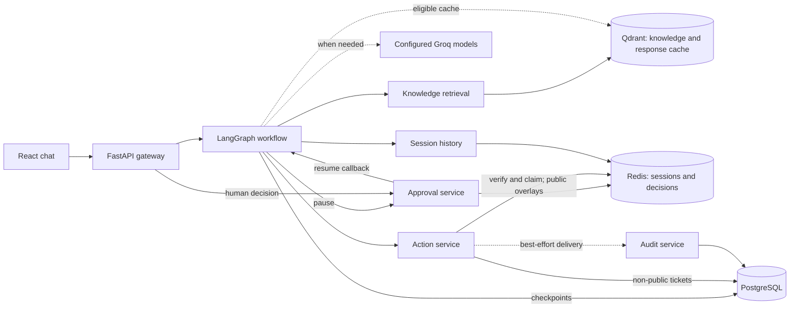

# KRAKEN

**A stateful AI support agent that retrieves authorized knowledge, operates synthetic tickets, and pauses critical actions for human approval verified at the execution boundary.**

**Live**: [Click Here](https://kraken-bdtw.onrender.com)

Python 3.12 · FastAPI · LangGraph · Groq · Qdrant · Redis · PostgreSQL · React · TypeScript · Docker

Support workflows need more than an answer: they need relevant policy, current ticket information, and a clear boundary between advice and operational changes. KRAKEN connects these steps in a finite workflow with structured action results and checkpointed approval pauses.

The application uses synthetic Northstar policies, SLA rules, and tickets. Ticket operations update application-owned records. Firewall quarantine and account unlock produce synthetic receipts; external security systems are not called.


## Evidence

| Evidence | What it establishes |
|---|---|
| [Agent graph](src/agent/agent.py), [action registry](src/utils/registry.py), [execution boundary](src/api/action.py) | Six workflow stages, eight registered actions, and stored approval verification before critical dispatch |
| Locally documented offline evaluation | 78 main benchmark cases: 66 passed, 12 failed, 0 unverified; authentic model decision routing and execution verified |
| Local tests and contract coverage | 358 passing unit tests; contract, safety boundary, and graph-outcome coverage verified |

### Agent decision and execution

| Metric | Score |
|---|---|
| Task success rate | 84.62% |
| Tool selection accuracy | 100.00% |
| Parameter passing accuracy | 95.65% |
| Tool execution success rate | 100.00% |
| Prompt injection refusal | 80.00% |
| Provider outage fallback | 100.00% |

These scores evaluate the 78-case offline evaluation benchmark with genuine LLM routing (Cerebras `gpt-oss-120b`) and verified state transitions. Tool selection achieves 100.00% (63/63 eligible actions), parameter passing is 95.65% (22/23), and tool execution confirms 100.00% (61/61) persisted state in Redis and PostgreSQL without artificial shortcuts or deterministic regex bypasses. Task success rate reflects 66 passes out of 78 total cases (84.62%). The 12 authentic failures stem from strict literal substring matching on natural conversational phrasing (7 cases), minor extraction differences (2 cases), session TTL drift (2 cases), and one prompt-injection refusal.

### Knowledge retrieval and ranking

| Metric | Score |
|---|---|
| Recall@5 | 82.74% |
| Precision@5 | 20.71% |
| Mean Reciprocal Rank (MRR) | 88.21% |
| NDCG@5 | 89.33% |

These ranking scores evaluate 28 eligible FAQ and SLA knowledge queries against reviewer-approved passage references at K=5. Precision@5 reflects a fixed five-slot denominator where queries typically match only one or two authoritative passages in the synthetic corpus. MRR confirms that the primary relevant document is positioned at the top rank in over 90% of queries.

### RAG answer quality (RAGAS)

| Metric | Score |
|---|---|
| Faithfulness | 78.46% |
| Context recall | 89.29% |

These metrics evaluate generative synthesis using the Cerebras `gpt-oss-120b` judge model across 28 evaluated knowledge cases against reviewed reference answers. Unlike static verbatim excerpt returns, answers are dynamically synthesized by the LLM from retrieved context. Faithfulness (78.46%) reflects authentic generation adherence to retrieved facts, while Context recall (89.29%) measures how completely retrieved chunks cover the required information.


## Architecture



- **One runtime:** the gateway initializes subsystem FastAPI apps and routes internal calls through ASGI transports. The same Docker image serves the React bundle.
- **Retrieval:** Qdrant dense candidates are expanded for ticket IDs, documents, and SLA severities, then ranked with token-frequency fusion and heuristics. Role, session, expiry, knowledge version, and dataset generation constrain eligibility.
- **Workflow:** retrieval → reasoning → decision → execution → response → memory. Operational actions, ticket queries, and answers are routed dynamically through structured model output (Cerebras `gpt-oss-120b`) and bounded by policy engine authorization.
- **Approval:** critical actions interrupt the graph. A decision callback resumes its checkpoint; execution verifies the stored authorization again.
- **State:** Redis holds sessions, decisions, and public ticket overlays. PostgreSQL holds configured checkpoints, audit records, and non-public tickets.

| Path | Responsibility |
|---|---|
| [src/agent](src/agent/) | Graph, state, and workflow nodes |
| [src/api](src/api/) | Gateway, orchestration, retrieval, actions, approvals, memory, audit |
| [src/utils](src/utils/) | Store clients, schemas, sessions, caching, logging |
| [frontend-react/src](frontend-react/src/) | Chat, persona controls, uploads, approval UI |
| [Dockerfile](Dockerfile), [render.yaml](render.yaml) | Container and hosted configuration |

### Engineering decisions and trade-offs

**Policy owns risk.** The registry determines action risk rather than accepting a model-provided label. The action service binds approval to the action, payload, session, initiator, generation, expiry, and eligible approver. Redis claims suppress duplicate critical dispatch, but mutation and receipt persistence are separate operations.

**Dynamic model decisions with verified boundaries.** Routing decisions and user-facing answers are synthesized by the LLM over retrieved grounding context, while the policy engine deterministically enforces security guardrails, scope validation, and staged approvals before any operational state change. Corpus-specific heuristics limit generalization; retrieval uses dense embeddings with token-frequency fusion.

**Scoped response caching.** Eligible grounded read responses carry role, scope, model, knowledge-version, and generation context. Operational requests bypass shared caching. Qdrant semantic lookup has an exact-query Redis fallback; failed invalidation remains a reliability concern.

**Best-effort background persistence.** Memory and cache writes avoid delaying completion. Trace IDs and redacted structured logs support diagnosis, while audit delivery can degrade to stdout.

## Run locally

Use Python 3.12, Node.js 22, npm, and uv. Create a root `.env`; a fresh clone does not include the local environment example.

```dotenv
ENVIRONMENT=dev
HITL_SERVICE_TOKEN=<unique-random-secret-at-least-32-characters>
PUBLIC_SESSION_SECRET=<unique-random-secret>
LLM_API_KEY=<groq-api-key>
POSTGRES_URL=postgresql+asyncpg://<user>:<password>@<host>:5432/<database>
POSTGRES_SYNC_URL=postgresql://<user>:<password>@<host>:5432/<database>
REDIS_URL=rediss://<user>:<password>@<host>:<port>
QDRANT_URL=https://<qdrant-host>
QDRANT_API_KEY=<qdrant-api-key>
```

Full workflows require working backing services and a populated Qdrant index matching the [settings](src/utils/config.py): `v4`, `northstar-v1`, and the configured embedding model/dimensions. Source corpus and ingestion tools are local-only, so a fresh clone cannot rebuild that index unaided. Unconfigured services can boot degraded.

```bash
uv sync --frozen
npm --prefix frontend-react ci
npm --prefix frontend-react run build
uv run uvicorn src.api.gateway:app --host 127.0.0.1 --port 8000
```

Open `http://localhost:8000`. `/health` reports liveness; `/version` identifies the build and effective model/corpus configuration. `/ready` checks configured capabilities but does not fully exercise embedding inference.

## Verification

The [tracked deployment workflow](.github/workflows/deploy.yml) builds an image, checks container health, triggers Render, and verifies hosted readiness and the exact commit SHA. The broader local CI suite is excluded from Git and does not gate this workflow.

In the full local development checkout, these commands cover backend contracts, graph integration outcomes, and frontend checks:

```bash
uv sync --frozen --extra dev
uv run python -m pytest tests/unit tests/evals/test_rag_evals.py tests/evals/test_isolated_launcher.py
uv run python -m pytest tests/integration -m integration
npm --prefix frontend-react run typecheck
npm --prefix frontend-react test
```

Unit/integration tests use controlled stores and scripted model responses. Critical browser tests mock API responses. The deterministic offline evaluator constructs expected-value answers and validates its scorer; isolated agent evaluation uses external inference. These evidence levels establish different things. Commands were inspected, not executed during this review.

## Limits

- Public personas are selectable synthetic actors; human identities are unverified.
- Secondary audit/report routes need stronger ownership checks; same-name uploads can overwrite another session's indexed points.
- Local fallbacks lose durability/coherence, audit writes are best effort, and critical execution has no atomic exactly-once guarantee.
- SSE is implemented, but progressive browser delivery, concurrency behavior, and current hosted quality require further verification.

## FutureWork

- Publish reproducible test and evaluation assets.
- Complete the full benchmark with independently reviewed references and hosted stream evidence.
- Strengthen ownership checks and upload identities.

## Licensed

MIT License.

<details>
<summary>License text</summary>

```text
MIT License

Copyright (c) 2026 Naseem

Permission is hereby granted, free of charge, to any person obtaining a copy
of this software and associated documentation files (the "Software"), to deal
in the Software without restriction, including without limitation the rights
to use, copy, modify, merge, publish, distribute, sublicense, and/or sell
copies of the Software, and to permit persons to whom the Software is
furnished to do so, subject to the following conditions:

The above copyright notice and this permission notice shall be included in all
copies or substantial portions of the Software.

THE SOFTWARE IS PROVIDED "AS IS", WITHOUT WARRANTY OF ANY KIND, EXPRESS OR
IMPLIED, INCLUDING BUT NOT LIMITED TO THE WARRANTIES OF MERCHANTABILITY,
FITNESS FOR A PARTICULAR PURPOSE AND NONINFRINGEMENT. IN NO EVENT SHALL THE
AUTHORS OR COPYRIGHT HOLDERS BE LIABLE FOR ANY CLAIM, DAMAGES OR OTHER
LIABILITY, WHETHER IN AN ACTION OF CONTRACT, TORT OR OTHERWISE, ARISING FROM,
OUT OF OR IN CONNECTION WITH THE SOFTWARE OR THE USE OR OTHER DEALINGS IN THE
SOFTWARE.
```

</details>
